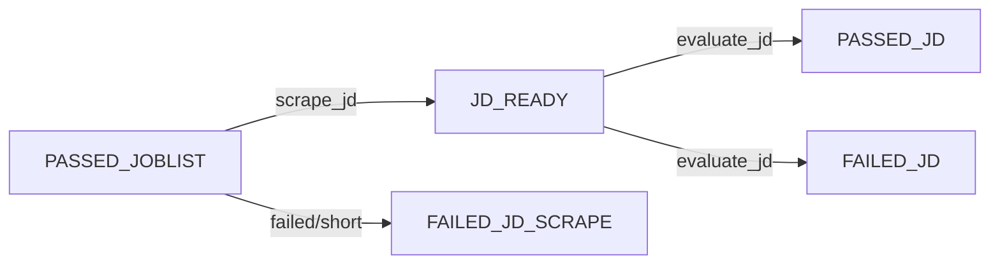

<!-- linear-archive: AST-326 archived 2026-06-03 -->

## Linear archive (AST-326)

**Archived:** 2026-06-03  
**Linear URL:** https://linear.app/astralcareermatch/issue/AST-326/batch-scrape-jds  
**Status at archive:** Done  
**Project:** Astral Gazer  
**Assignee:** susan  
**Priority / estimate:** None / —  
**Parent:** —  
**Blocked by / blocks / related:** —

### Description

—

### Comments

_No comments._

---

# AST-326: Batch Scrape JDs

Add `scrape_jd` task (PASSED_JOBLIST → JD_READY), batch `evaluate_jd` via `_run_batch_consult` helper, and clean up the coat-check and dispatcher.

## New State Flow



## Changes

### 1. [`src/utils/config.py`](src/utils/config.py)

- Add `JD_READY` and `FAILED_JD_SCRAPE` to `JOB_STATES` with `batch_criteria`
- Add transitions `(PASSED_JOBLIST, JD_READY)` and `(PASSED_JOBLIST, FAILED_JD_SCRAPE)` to `TRACKER_CONFIG["job_state_transitions"]`
- Add `JD_READY` to `IN_REVIEW_STATES` (between `PASSED_JOBLIST` and `PASSED_JD`)
- Add `FAILED_JD_SCRAPE` to `SKIPPED_STATES`
- Add `scrape_jd` to `DISPATCH_TASKS`: `{"entity_type": "job", "trigger_state": "PASSED_JOBLIST"}`
- Add `scrape_jd` block to `CONSULT_CONFIG` — no `batch_size`:
  ```python
  "scrape_jd": {
      "input_state": "PASSED_JOBLIST",
      "pass_state": "JD_READY",
      "fail_state": "FAILED_JD_SCRAPE",
  }
  ```
- Remove `playwright_session_limit` from `ASTRAL_CONFIG` entirely
- Change `evaluate_jd["input_state"]` from `"PASSED_JOBLIST"` to `"JD_READY"`
- Add `"input_state": "NEW"` to `qualify_job_listings` (fixing the hardcoded bug)
- Update `evaluate_jd` response schema from single-job `{"grades": [...]}` to batch `{"jobs": [{"astral_job_id": ..., "grades": [...]}, ...]}`

### 2. [`src/core/gazer.py`](src/core/gazer.py)

- Move `_prune_jd` here from `tracker.py`
- Add `scrape_jd_batch(batch_id, jobs, debug)`:
  - `asyncio.gather` over all jobs — batch size controls concurrency, no semaphore
  - `_prune_jd` + `jd_min_chars` gate per job
  - fail → transition to `FAILED_JD_SCRAPE`, pass → save to `job_data` + transition to `JD_READY`

### 3. [`src/core/consult.py`](src/core/consult.py)

Add `_run_batch_consult(task_key, batch_id, jobs, assemble_fn, process_fn, ctx, debug)`:

- `live_content = assemble_fn(jobs)` — caller-supplied
- Single `do_task(task_key, live_content, ...)` call
- Shared: ID reconciliation (missing/fabricated), audit entry, batch error transition on failure
- Per matched job: `to_state = process_fn(input_job, response_job, cfg)`
- Returns `{"success", "passed", "failed", "total", "missing", "fabricated", "bad_grades"}`

`qualify_job_listings` becomes a thin wrapper:

```python
async def qualify_job_listings(batch_id, jobs, ctx, debug):
    def assemble(jobs): return enumerate_array("JOB LISTINGS", [...raw_html...], ...)
    def process(input_job, response_job, cfg):
        tracker.initialize_job(...)
        tracker.save_job_data(..., {"joblist_grades": response_job["grades"]})
        return _render_pass_fail(...)
    return await _run_batch_consult("qualify_job_listings", batch_id, jobs, assemble, process, ctx, debug)
```

`evaluate_jd_batch` is the new thin wrapper for JD evaluation:

```python
async def evaluate_jd_batch(batch_id, jobs, ctx, debug):
    def assemble(jobs): return enumerate_array("JD LISTINGS", [...jd_text...], ...)
    def process(input_job, response_job, cfg):
        tracker.save_job_data(..., {"jd_grades": response_job["grades"]})
        return _render_pass_fail(...)
    return await _run_batch_consult("evaluate_jd", batch_id, jobs, assemble, process, ctx, debug)
```

### 4. [`src/core/dispatcher.py`](src/core/dispatcher.py)

- `_run_evaluate_jd` becomes Pattern A — calls `evaluate_jd_batch(bid, jobs, ...)` directly, no `_warm_then_gather`, no per-job loop, no Phase 1 prefetch block
- Add `_run_scrape_jd(ctx, limit, debug)`: reads from `CONSULT_CONFIG["scrape_jd"]`, calls `scrape_jd_batch`, register in `_RUNNERS`
- Fix `_run_qualify` hardcoded `"NEW"` → `task_cfg["input_state"]`

### 5. [`src/core/tracker.py`](src/core/tracker.py)

- Remove `_prune_jd` (moved to `gazer.py`)
- Keep coat-check self-heal in `get_job_data` but replace inline fetch+prune with `scrape_jd_batch(str(uuid.uuid4()), [job])` — single-job, same code path, no duplication

---

## Bug: AST-2145 — coat-check JD self-heal skips link-less jobs and never makes an illegal transition

Fix child of orphaned bug [AST-2143](https://linear.app/astralcareermatch/issue/AST-2143) (full production log there). Patches §5 above (`tracker.py` self-heal delegation). Most recent change on this path: AST-2133 (`docs/features/foundation/ast-2133-composed-read-only-job-description.md`), which moved the trigger onto composed length and left the self-heal block as it was.

### As-is

`tracker.get_job_data(job, "job_description")` self-heals whenever `compose_job_description(job)` is shorter than `jd_min_chars`. It always calls `gazer.fetch_jd_batch(uuid, [job])`, which runs the `fetch_jd` dispatch task's transitions: `JD_READY` on pass, `ERROR_FETCH_JD_UNREADABLE` on no `job_link`, scrape error, or short text, and `GAZER_CONFIG["fetch_jd"]["classified_states"]` on a classified page. The only callers are the consult tasks, through `consult._prep_live_content`, and they run from downstream states such as `JD_READY` and `METEORITE_PASSED_JD`. None of those states is a legal prior of the fetch-stage destinations, so `transition_job_state` raises `Invalid transition`. `get_job_data` catches that, logs `fetch_jd_batch self-heal failed`, and returns `None`. Consult then moves the job to its task's `error_state` with the reason `no live content`.

On a successful scrape, `_apply_jd_gates` has already written `jd_telescope_data_id` before the transition raises. So the self-heal currently never heals anything for a real caller: it scrapes, writes the reference, throws, and returns `None`. With no `job_link` (body-mode meteorite ingest, AST-1132), it also logs `no job_link, cannot scrape JD` plus the `Invalid transition` noise.

### To-be

- Short composed JD, no `job_link`: no self-heal attempt. Log one warning, `[<id>] JD short, no job_link — cannot self-heal`, and return `None`.
- Short composed JD, with a `job_link`: the self-heal scrapes and gates exactly as `fetch_jd` does, but **never transitions state**. On pass, it keeps the capture, writes `jd_telescope_data_id`, and returns the healed composed JD. On any failure, the job's state is left alone and the function returns `None`.
- A job with no usable JD still lands in its task's `error_state` with `no live content` (the consult prep loop is unchanged). There is no `Invalid transition` and no `self-heal failed` line for a link-less job.
- `fetch_jd_batch` behaves exactly as before for the `fetch_jd` dispatch task (`consult.py` ~3062), and so does `_apply_jd_gates` for `fetch_relative_jd_batch`.

### Repro

The fixture matches production job `4d9d1c79` (AST-2143). Persistence is DB-backed, so seed the job row (or patch `database.get_job`) with this shape:

```python
job = {
    "astral_job_id": "4d9d1c79-fd62-4639-a5d8-885c01d808bd",
    "state": "METEORITE_PASSED_JD",
    "job_link": "",
    "job_title": "Engineer",
    "job_data": {"job_description": "Short meteorite preamble."},  # < jd_min_chars, no jd_telescope_data_id
}
await tracker.get_job_data(job, "job_description")
```

- **As-is:** logs `coat-check self-heal`, then `no job_link, cannot scrape JD`, then `fetch_jd_batch self-heal failed … Invalid transition: METEORITE_PASSED_JD -> ERROR_FETCH_JD_UNREADABLE`, and returns `None`.
- **To-be (no link):** logs only `JD short, no job_link — cannot self-heal`, returns `None`, and never calls `fetch_jd_batch`.
- **Second fixture (with link):** the same job with `"job_link": "https://example.com/jobs/1"`, and `scrape_visible_text_and_keep` patched to return `("Engineer\n" + "y" * 250, None, "<row-id>")`.
  - As-is: the reference gets saved, then `Invalid transition: METEORITE_PASSED_JD -> JD_READY`, and the function returns `None`.
  - To-be: returns `"Short meteorite preamble.\n\n" + <pruned capture>`, the state stays `METEORITE_PASSED_JD`, and `jd_telescope_data_id == "<row-id>"`.

### Root cause

AST-326 §5 made the coat-check delegate to the batch fetch ("single-job, same code path, no duplication"). That shared code path includes the `fetch_jd` task's state transitions, which are only legal from that task's own input states (`PASSED_JOBLIST` / `RELATIVE_JOB_LINK` and their retries). The coat-check runs from later tasks' states, so every outcome the delegation can produce is an illegal transition. There is also no `job_link` check ahead of the delegation.

### Proposed change

**Design choice: option (a), a no-transition single-job mode on `fetch_jd_batch`.** Why: option (b) would turn the self-heal off for every current caller, because no consult input state is a legal prior of all fetch-stage destinations. That would quietly delete the feature AST-326 §5 chose to keep.

1. **`src/core/gazer.py` — `_apply_jd_gates`:** add a keyword-only `transition: bool = True`.
   - Wrap each of the three `transition_job_state([aid], …)` calls (empty, too short, classified) and the pass-branch call in `if transition:`.
   - **Classified branch:** when `transition` is False, skip `save_job_data(aid, {ref_key: telescope_data_id})` as well, and return `False`. A cookie, bot, missing, or closed page must not become the composed JD of a job that stays in its downstream state. With `transition=True` the order stays save first, then transition.
   - **Pass branch:** `save_job_data` and the in-memory write-back are unchanged in both modes. Only the transition is gated.
   - **Warning log lines:** where they print the destination (`"%s -> %s [...]"`), pass `short_state if transition else "state kept"` (or `error_state if transition else "state kept"`) as the destination argument, so a self-heal never logs a move that didn't happen.
   - `fetch_relative_jd_batch` (~473) passes no kwarg and is unchanged.
2. **`src/core/gazer.py` — `fetch_jd_batch`:** add a keyword-only `transition: bool = True` after `debug`.
   - In `_scrape_one`, wrap the no-`job_link` branch's and the scrape-error branch's `transition_job_state([aid], fail_state)` in `if transition:`.
   - Pass `transition=transition` to `_apply_jd_gates`.
   - Add one docstring line: `transition=False: coat-check mode — scrape, gate and keep the capture, never move state (AST-2145).`
   - The connectivity check, counters, and return shape are unchanged. The dispatch caller in `consult.py` passes no kwarg and is unchanged.
3. **`src/core/tracker.py` — `get_job_data`**, after the `len(composed) >= min_chars` happy path:
   - Read `astral_job_id`. If `(job.get("job_link") or "").strip()` is empty, call `logger.warning(f"[{astral_job_id}] JD short, no job_link — cannot self-heal")` and `return None`. This goes *before* the existing `coat-check self-heal` warning, so a link-less job logs exactly one line.
   - Otherwise keep the existing warning and the `try`/`except` (an exception still means a warning plus `return None`, which covers `ConnectionError` from the connectivity check). Change the call to `await fetch_jd_batch(str(uuid.uuid4()), [job], transition=False)`.
   - After the call: `healed = compose_job_description(job)` and `return healed if len(healed) >= min_chars else None`.
   - Update the docstring. Short JD: self-heal via `fetch_jd_batch(transition=False)` when a `job_link` exists, never moving state. Returns the composed JD once it is at least `jd_min_chars`, else `None`.
   - Update the comment above the call so it says the delegation is transition-free.

**Explicit decision, flagged for fix-board:** AST-2143 Proposed step 2 says "return `compose_job_description(job) or None`" after the no-link skip. Proposed step 4 and the To-be ("a link-less, short-JD job should land in `ERROR_METEORITE_GRADE_DO`", and "still lands in its task's `error_state`, as it does today") require `None` whenever the JD is still short. A short but non-empty preamble is truthy and would get graded instead of erroring. This plan returns `None` whenever the composed JD is still under `jd_min_chars`, on both the no-link path and the failed-heal path. That matches today's observed outcome for every real caller and step 4's expected re-run result.

### Blast radius

- **Callers of `get_job_data`:** only `consult._prep_live_content`. That covers the batch prep loop (~2532, which routes falsy to `error_state` with `no live content`), the single-job consult (~1505), the analysis upshot (~1236), and `agent.py` ~1890 (manual agent run). The no-link and failed-heal paths still return `None`, as they do today. The new behavior is a successful heal on a downstream job with a `job_link`: it now returns a usable JD and gets graded, where today it errors.
- **`fetch_jd_batch`:** the dispatch caller (`consult.py` ~3062) uses the default `transition=True`, so nothing changes for it.
- **`_apply_jd_gates`:** `fetch_relative_jd_batch` (~473) uses the default, so nothing changes for it.
- **Tests that assume the current self-heal** (Betty — test tree is off-limits to engineers), all in `tests/component/core/test_tracker.py`:
  - `TestGetJobData.test_self_heals_short_job_description`: the job has no `job_link`, so the guard now skips the scrape and `assert_awaited_once` fails.
  - `TestGetJobData.test_self_heal_failure_returns_none`: no `job_link`, so it still returns `None`, but through the guard rather than the exception path. It needs a link to keep covering the exception branch.
  - `test_self_heal_writes_reference_then_returns_composed` (~180): the fake `_fetch(batch_id, jobs)` doesn't accept `transition`, and the job needs a `job_link`.
  - gazer `fetch_jd_batch` / `_apply_jd_gates` tests keep passing on the default, but need new coverage for `transition=False`.
- **Not touched:** `compose_job_description`, `jd_min_chars`, consult's `no live content` routing, `fetch_relative_jd_batch`, the state registry and transitions in `config.py`. The `AllLiteralXGradeSetError` and `ADX4` retries in the same log are covered by AST-2011 and AST-2045.

### What must still hold

- AST-326 §5: the coat-check self-heal still lives in `get_job_data` and reuses the batch fetch's scrape, prune, and gate code. Prune and gate rules still live in one place (`_apply_jd_gates`), with no duplication.
- `fetch_jd` dispatch: the `PASSED_JOBLIST` / `RELATIVE_JOB_LINK` → `JD_READY` / `ERROR_FETCH_JD_UNREADABLE` / classified-state flow and its logs are unchanged, and so is `fetch_relative_jd_batch`.
- AST-2130 / AST-2133: `job_description` stays the preamble and is never overwritten. The scraped JD is stored only as the `jd_telescope_data_id` reference, and `get_job_data` still returns the composed JD (preamble plus pruned capture).
- The happy path (composed JD at least `jd_min_chars`) returns immediately, with no scrape and no log.
- A job with no usable JD still ends in its consult task's `error_state` with `no live content`, as it does today.
- The self-heal never calls `transition_job_state`, whatever the job's current state.

## Joan fix-board — AST-2145

## Verdict (for Chuckles to post)

```
[board-joan]  CANON: OK
```

## Stdout

```text
AST-2145 board-joan done — CANON: OK.
```

## Reasoning

Reviewed the `## Bug: AST-2145` plan-fix block on `origin/sub/AST-2143/AST-2145-jd-self-heal-guard` (As-is / To-be / Proposed change / Blast radius / What must still hold) and skimmed overlapping in-force directives via `canon/docs/DIRECTIVES-DIRECTORY.md` plus targeted reads: `astral.state.job-prior-states-enforced`, `astral.state.core-decides-transitions`, `astral.idioms.coat-check-never-store-empty`, `patt.entity.batch-processing`, `stat.logging.*` entity lines.

The bug is calling `fetch_jd_batch` (with `fetch_jd` dispatch transitions) from `get_job_data` while the job sits in downstream consult states, which forces illegal `transition_job_state` attempts. Option (a)—`transition=False` on `_apply_jd_gates` / `fetch_jd_batch` for coat-check only—**aligns** with prior-states enforcement by not invoking transitions from that read path, while leaving dispatch (`consult.py` ~3062) and `fetch_relative_jd_batch` on the default `transition=True`. No active statute requires batch JD gating to always move state; core still chooses whether to transition (here: explicitly not on self-heal).

`astral.idioms.coat-check-never-store-empty` stays satisfied: link-less short JD returns `None` without scrape; failed heal returns `None`; classified pages in coat-check mode skip persisting `jd_telescope_data_id` (failure, not caching empty). Pass path still writes the reference and returns composed JD when length clears `jd_min_chars`, matching AST-2130/2133 “preamble + reference” behavior in **What must still hold**.

The AST-2143 step-2 vs step-4 `None` vs truthy-preamble call in the plan is a **product/plan consistency** choice already resolved in Proposed change (always `None` when still under `jd_min_chars`); it does not need a new canon carve-out or Archie gate.

No parent **Canon Scope** frozen list was available on this ref (same pattern as other fix-board passes: registry skim only, not F3 R1–R7).

---

context_tokens≈18500

**Chuckles routing:** CANON: OK. Betty's `[board-betty] TESTS: REVISE` routes to a test-gap sibling, so qa-fix is skipped on AST-2145.
