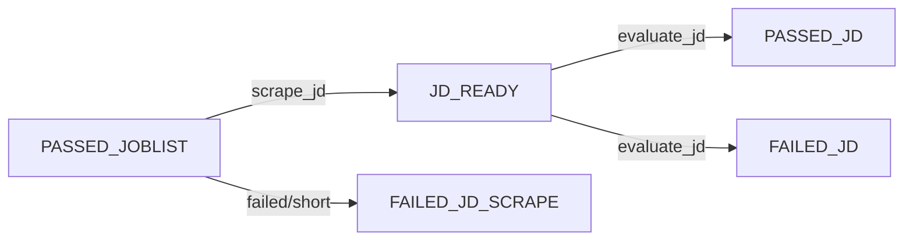

<!-- linear-archive: AST-326 archived 2026-06-03 -->

## Linear archive (AST-326)

**Archived:** 2026-06-03  
**Linear URL:** https://linear.app/astralcareermatch/issue/AST-326/batch-scrape-jds  
**Status at archive:** Done  
**Project:** Astral Gazer  
**Assignee:** susan  
**Priority / estimate:** None / —  
**Parent:** —  
**Blocked by / blocks / related:** —

### Description

—

### Comments

_No comments._

---

# AST-326: Batch Scrape JDs

Add `scrape_jd` task (PASSED_JOBLIST → JD_READY), batch `evaluate_jd` via `_run_batch_consult` helper, and clean up the coat-check and dispatcher.

## New State Flow



## Changes

### 1. [`src/utils/config.py`](src/utils/config.py)

- Add `JD_READY` and `FAILED_JD_SCRAPE` to `JOB_STATES` with `batch_criteria`
- Add transitions `(PASSED_JOBLIST, JD_READY)` and `(PASSED_JOBLIST, FAILED_JD_SCRAPE)` to `TRACKER_CONFIG["job_state_transitions"]`
- Add `JD_READY` to `IN_REVIEW_STATES` (between `PASSED_JOBLIST` and `PASSED_JD`)
- Add `FAILED_JD_SCRAPE` to `SKIPPED_STATES`
- Add `scrape_jd` to `DISPATCH_TASKS`: `{"entity_type": "job", "trigger_state": "PASSED_JOBLIST"}`
- Add `scrape_jd` block to `CONSULT_CONFIG` — no `batch_size`:
  ```python
  "scrape_jd": {
      "input_state": "PASSED_JOBLIST",
      "pass_state": "JD_READY",
      "fail_state": "FAILED_JD_SCRAPE",
  }
  ```
- Remove `playwright_session_limit` from `ASTRAL_CONFIG` entirely
- Change `evaluate_jd["input_state"]` from `"PASSED_JOBLIST"` to `"JD_READY"`
- Add `"input_state": "NEW"` to `qualify_job_listings` (fixing the hardcoded bug)
- Update `evaluate_jd` response schema from single-job `{"grades": [...]}` to batch `{"jobs": [{"astral_job_id": ..., "grades": [...]}, ...]}`

### 2. [`src/core/gazer.py`](src/core/gazer.py)

- Move `_prune_jd` here from `tracker.py`
- Add `scrape_jd_batch(batch_id, jobs, debug)`:
  - `asyncio.gather` over all jobs — batch size controls concurrency, no semaphore
  - `_prune_jd` + `jd_min_chars` gate per job
  - fail → transition to `FAILED_JD_SCRAPE`, pass → save to `job_data` + transition to `JD_READY`

### 3. [`src/core/consult.py`](src/core/consult.py)

Add `_run_batch_consult(task_key, batch_id, jobs, assemble_fn, process_fn, ctx, debug)`:

- `live_content = assemble_fn(jobs)` — caller-supplied
- Single `do_task(task_key, live_content, ...)` call
- Shared: ID reconciliation (missing/fabricated), audit entry, batch error transition on failure
- Per matched job: `to_state = process_fn(input_job, response_job, cfg)`
- Returns `{"success", "passed", "failed", "total", "missing", "fabricated", "bad_grades"}`

`qualify_job_listings` becomes a thin wrapper:

```python
async def qualify_job_listings(batch_id, jobs, ctx, debug):
    def assemble(jobs): return enumerate_array("JOB LISTINGS", [...raw_html...], ...)
    def process(input_job, response_job, cfg):
        tracker.initialize_job(...)
        tracker.save_job_data(..., {"joblist_grades": response_job["grades"]})
        return _render_pass_fail(...)
    return await _run_batch_consult("qualify_job_listings", batch_id, jobs, assemble, process, ctx, debug)
```

`evaluate_jd_batch` is the new thin wrapper for JD evaluation:

```python
async def evaluate_jd_batch(batch_id, jobs, ctx, debug):
    def assemble(jobs): return enumerate_array("JD LISTINGS", [...jd_text...], ...)
    def process(input_job, response_job, cfg):
        tracker.save_job_data(..., {"jd_grades": response_job["grades"]})
        return _render_pass_fail(...)
    return await _run_batch_consult("evaluate_jd", batch_id, jobs, assemble, process, ctx, debug)
```

### 4. [`src/core/dispatcher.py`](src/core/dispatcher.py)

- `_run_evaluate_jd` becomes Pattern A — calls `evaluate_jd_batch(bid, jobs, ...)` directly, no `_warm_then_gather`, no per-job loop, no Phase 1 prefetch block
- Add `_run_scrape_jd(ctx, limit, debug)`: reads from `CONSULT_CONFIG["scrape_jd"]`, calls `scrape_jd_batch`, register in `_RUNNERS`
- Fix `_run_qualify` hardcoded `"NEW"` → `task_cfg["input_state"]`

### 5. [`src/core/tracker.py`](src/core/tracker.py)

- Remove `_prune_jd` (moved to `gazer.py`)
- Keep coat-check self-heal in `get_job_data` but replace inline fetch+prune with `scrape_jd_batch(str(uuid.uuid4()), [job])` — single-job, same code path, no duplication

---

## Bug: AST-2145 — coat-check JD self-heal skips link-less jobs and never makes an illegal transition

Fix child of orphaned bug [AST-2143](https://linear.app/astralcareermatch/issue/AST-2143) (full production log there). Patches §5 above (`tracker.py` self-heal delegation). Most recent change on this path: AST-2133 (`docs/features/foundation/ast-2133-composed-read-only-job-description.md`), which moved the trigger onto composed length and left the self-heal block as it was.

### As-is

`tracker.get_job_data(job, "job_description")` self-heals whenever `compose_job_description(job)` is shorter than `jd_min_chars`. It always calls `gazer.fetch_jd_batch(uuid, [job])`, which runs the `fetch_jd` dispatch task's transitions: `JD_READY` on pass, `ERROR_FETCH_JD_UNREADABLE` on no `job_link`, scrape error, or short text, and `GAZER_CONFIG["fetch_jd"]["classified_states"]` on a classified page. The only callers are the consult tasks, through `consult._prep_live_content`, and they run from downstream states such as `JD_READY` and `METEORITE_PASSED_JD`. None of those states is a legal prior of the fetch-stage destinations, so `transition_job_state` raises `Invalid transition`. `get_job_data` catches that, logs `fetch_jd_batch self-heal failed`, and returns `None`. Consult then moves the job to its task's `error_state` with the reason `no live content`.

On a successful scrape, `_apply_jd_gates` has already written `jd_telescope_data_id` before the transition raises. So the self-heal currently never heals anything for a real caller: it scrapes, writes the reference, throws, and returns `None`. With no `job_link` (body-mode meteorite ingest, AST-1132), it also logs `no job_link, cannot scrape JD` plus the `Invalid transition` noise.

### To-be

- Short composed JD, no `job_link`: no self-heal attempt. Log one warning, `[<id>] JD short, no job_link — cannot self-heal`, and return `None`.
- Short composed JD, with a `job_link`: the self-heal scrapes and gates exactly as `fetch_jd` does, but **never transitions state**. On pass, it keeps the capture, writes `jd_telescope_data_id`, and returns the healed composed JD. On any failure, the job's state is left alone and the function returns `None`.
- A job with no usable JD still lands in its task's `error_state` with `no live content` (the consult prep loop is unchanged). There is no `Invalid transition` and no `self-heal failed` line for a link-less job.
- `fetch_jd_batch` behaves exactly as before for the `fetch_jd` dispatch task (`consult.py` ~3062), and so does `_apply_jd_gates` for `fetch_relative_jd_batch`.

### Repro

The fixture matches production job `4d9d1c79` (AST-2143). Persistence is DB-backed, so seed the job row (or patch `database.get_job`) with this shape:

```python
job = {
    "astral_job_id": "4d9d1c79-fd62-4639-a5d8-885c01d808bd",
    "state": "METEORITE_PASSED_JD",
    "job_link": "",
    "job_title": "Engineer",
    "job_data": {"job_description": "Short meteorite preamble."},  # < jd_min_chars, no jd_telescope_data_id
}
await tracker.get_job_data(job, "job_description")
```

- **As-is:** logs `coat-check self-heal`, then `no job_link, cannot scrape JD`, then `fetch_jd_batch self-heal failed … Invalid transition: METEORITE_PASSED_JD -> ERROR_FETCH_JD_UNREADABLE`, and returns `None`.
- **To-be (no link):** logs only `JD short, no job_link — cannot self-heal`, returns `None`, and never calls `fetch_jd_batch`.
- **Second fixture (with link):** the same job with `"job_link": "https://example.com/jobs/1"`, and `scrape_visible_text_and_keep` patched to return `("Engineer\n" + "y" * 250, None, "<row-id>")`.
  - As-is: the reference gets saved, then `Invalid transition: METEORITE_PASSED_JD -> JD_READY`, and the function returns `None`.
  - To-be: returns `"Short meteorite preamble.\n\n" + <pruned capture>`, the state stays `METEORITE_PASSED_JD`, and `jd_telescope_data_id == "<row-id>"`.

### Root cause

AST-326 §5 made the coat-check delegate to the batch fetch ("single-job, same code path, no duplication"). That shared code path includes the `fetch_jd` task's state transitions, which are only legal from that task's own input states (`PASSED_JOBLIST` / `RELATIVE_JOB_LINK` and their retries). The coat-check runs from later tasks' states, so every outcome the delegation can produce is an illegal transition. There is also no `job_link` check ahead of the delegation.

### Proposed change

**Design choice: option (a), a no-transition single-job mode on `fetch_jd_batch`.** Why: option (b) would turn the self-heal off for every current caller, because no consult input state is a legal prior of all fetch-stage destinations. That would quietly delete the feature AST-326 §5 chose to keep.

1. **`src/core/gazer.py` — `_apply_jd_gates`:** add a keyword-only `transition: bool = True`.
   - Wrap each of the three `transition_job_state([aid], …)` calls (empty, too short, classified) and the pass-branch call in `if transition:`.
   - **Classified branch:** when `transition` is False, skip `save_job_data(aid, {ref_key: telescope_data_id})` as well, and return `False`. A cookie, bot, missing, or closed page must not become the composed JD of a job that stays in its downstream state. With `transition=True` the order stays save first, then transition.
   - **Pass branch:** `save_job_data` and the in-memory write-back are unchanged in both modes. Only the transition is gated.
   - **Warning log lines:** where they print the destination (`"%s -> %s [...]"`), pass `short_state if transition else "state kept"` (or `error_state if transition else "state kept"`) as the destination argument, so a self-heal never logs a move that didn't happen.
   - `fetch_relative_jd_batch` (~473) passes no kwarg and is unchanged.
2. **`src/core/gazer.py` — `fetch_jd_batch`:** add a keyword-only `transition: bool = True` after `debug`.
   - In `_scrape_one`, wrap the no-`job_link` branch's and the scrape-error branch's `transition_job_state([aid], fail_state)` in `if transition:`.
   - Pass `transition=transition` to `_apply_jd_gates`.
   - Add one docstring line: `transition=False: coat-check mode — scrape, gate and keep the capture, never move state (AST-2145).`
   - The connectivity check, counters, and return shape are unchanged. The dispatch caller in `consult.py` passes no kwarg and is unchanged.
3. **`src/core/tracker.py` — `get_job_data`**, after the `len(composed) >= min_chars` happy path:
   - Read `astral_job_id`. If `(job.get("job_link") or "").strip()` is empty, call `logger.warning(f"[{astral_job_id}] JD short, no job_link — cannot self-heal")` and `return None`. This goes *before* the existing `coat-check self-heal` warning, so a link-less job logs exactly one line.
   - Otherwise keep the existing warning and the `try`/`except` (an exception still means a warning plus `return None`, which covers `ConnectionError` from the connectivity check). Change the call to `await fetch_jd_batch(str(uuid.uuid4()), [job], transition=False)`.
   - After the call: `healed = compose_job_description(job)` and `return healed if len(healed) >= min_chars else None`.
   - Update the docstring. Short JD: self-heal via `fetch_jd_batch(transition=False)` when a `job_link` exists, never moving state. Returns the composed JD once it is at least `jd_min_chars`, else `None`.
   - Update the comment above the call so it says the delegation is transition-free.

**Explicit decision, flagged for fix-board:** AST-2143 Proposed step 2 says "return `compose_job_description(job) or None`" after the no-link skip. Proposed step 4 and the To-be ("a link-less, short-JD job should land in `ERROR_METEORITE_GRADE_DO`", and "still lands in its task's `error_state`, as it does today") require `None` whenever the JD is still short. A short but non-empty preamble is truthy and would get graded instead of erroring. This plan returns `None` whenever the composed JD is still under `jd_min_chars`, on both the no-link path and the failed-heal path. That matches today's observed outcome for every real caller and step 4's expected re-run result.

### Blast radius

- **Callers of `get_job_data`:** only `consult._prep_live_content`. That covers the batch prep loop (~2532, which routes falsy to `error_state` with `no live content`), the single-job consult (~1505), the analysis upshot (~1236), and `agent.py` ~1890 (manual agent run). The no-link and failed-heal paths still return `None`, as they do today. The new behavior is a successful heal on a downstream job with a `job_link`: it now returns a usable JD and gets graded, where today it errors.
- **`fetch_jd_batch`:** the dispatch caller (`consult.py` ~3062) uses the default `transition=True`, so nothing changes for it.
- **`_apply_jd_gates`:** `fetch_relative_jd_batch` (~473) uses the default, so nothing changes for it.
- **Tests that assume the current self-heal** (Betty — test tree is off-limits to engineers), all in `tests/component/core/test_tracker.py`:
  - `TestGetJobData.test_self_heals_short_job_description`: the job has no `job_link`, so the guard now skips the scrape and `assert_awaited_once` fails.
  - `TestGetJobData.test_self_heal_failure_returns_none`: no `job_link`, so it still returns `None`, but through the guard rather than the exception path. It needs a link to keep covering the exception branch.
  - `test_self_heal_writes_reference_then_returns_composed` (~180): the fake `_fetch(batch_id, jobs)` doesn't accept `transition`, and the job needs a `job_link`.
  - gazer `fetch_jd_batch` / `_apply_jd_gates` tests keep passing on the default, but need new coverage for `transition=False`.
- **Not touched:** `compose_job_description`, `jd_min_chars`, consult's `no live content` routing, `fetch_relative_jd_batch`, the state registry and transitions in `config.py`. The `AllLiteralXGradeSetError` and `ADX4` retries in the same log are covered by AST-2011 and AST-2045.

### What must still hold

- AST-326 §5: the coat-check self-heal still lives in `get_job_data` and reuses the batch fetch's scrape, prune, and gate code. Prune and gate rules still live in one place (`_apply_jd_gates`), with no duplication.
- `fetch_jd` dispatch: the `PASSED_JOBLIST` / `RELATIVE_JOB_LINK` → `JD_READY` / `ERROR_FETCH_JD_UNREADABLE` / classified-state flow and its logs are unchanged, and so is `fetch_relative_jd_batch`.
- AST-2130 / AST-2133: `job_description` stays the preamble and is never overwritten. The scraped JD is stored only as the `jd_telescope_data_id` reference, and `get_job_data` still returns the composed JD (preamble plus pruned capture).
- The happy path (composed JD at least `jd_min_chars`) returns immediately, with no scrape and no log.
- A job with no usable JD still ends in its consult task's `error_state` with `no live content`, as it does today.
- The self-heal never calls `transition_job_state`, whatever the job's current state.

## Joan fix-board — AST-2145

## Verdict (for Chuckles to post)

```
[board-joan]  CANON: OK
```

## Stdout

```text
AST-2145 board-joan done — CANON: OK.
```

## Reasoning

Reviewed the `## Bug: AST-2145` plan-fix block on `origin/sub/AST-2143/AST-2145-jd-self-heal-guard` (As-is / To-be / Proposed change / Blast radius / What must still hold) and skimmed overlapping in-force directives via `canon/docs/DIRECTIVES-DIRECTORY.md` plus targeted reads: `astral.state.job-prior-states-enforced`, `astral.state.core-decides-transitions`, `astral.idioms.coat-check-never-store-empty`, `patt.entity.batch-processing`, `stat.logging.*` entity lines.

The bug is calling `fetch_jd_batch` (with `fetch_jd` dispatch transitions) from `get_job_data` while the job sits in downstream consult states, which forces illegal `transition_job_state` attempts. Option (a)—`transition=False` on `_apply_jd_gates` / `fetch_jd_batch` for coat-check only—**aligns** with prior-states enforcement by not invoking transitions from that read path, while leaving dispatch (`consult.py` ~3062) and `fetch_relative_jd_batch` on the default `transition=True`. No active statute requires batch JD gating to always move state; core still chooses whether to transition (here: explicitly not on self-heal).

`astral.idioms.coat-check-never-store-empty` stays satisfied: link-less short JD returns `None` without scrape; failed heal returns `None`; classified pages in coat-check mode skip persisting `jd_telescope_data_id` (failure, not caching empty). Pass path still writes the reference and returns composed JD when length clears `jd_min_chars`, matching AST-2130/2133 “preamble + reference” behavior in **What must still hold**.

The AST-2143 step-2 vs step-4 `None` vs truthy-preamble call in the plan is a **product/plan consistency** choice already resolved in Proposed change (always `None` when still under `jd_min_chars`); it does not need a new canon carve-out or Archie gate.

No parent **Canon Scope** frozen list was available on this ref (same pattern as other fix-board passes: registry skim only, not F3 R1–R7).

---

context_tokens≈18500

**Chuckles routing:** CANON: OK. Betty's `[board-betty] TESTS: REVISE` routes to a test-gap sibling, so qa-fix is skipped on AST-2145.

## Radia review — AST-2145 (review-fix)

```
[code-rubric]
**Ticket:** AST-2145
**Publish ref:** a17290ad3b33a2b28b4e2b671c493e2fe947d0f7 (`origin/sub/AST-2143/AST-2145-jd-self-heal-guard`)
**Corpus:** 26c4e86a4d08addcefdbc3be68116703fedf6762 (`canon/` tree at publish tip; no `docs/canon-index.md` on ref)
**Overall:** CLEAN

## Canon scores

Frozen canon list on the Linear description is **empty** (no R1–R7 / directive ids locked at Plan Approved). Per `review-child` §5.1, there are no list rows to grade; roll-up from canon grades is vacuously clean.

**Overlap triage (not scored — off frozen list):** The diff touches `get_job_data` coat-check and `fetch_jd_batch` / `_apply_jd_gates`. Joan’s fix-board skim named `astral.state.job-prior-states-enforced`, `astral.state.core-decides-transitions`, `astral.idioms.coat-check-never-store-empty`, `patt.entity.batch-processing`, and logging statutes. Implementation aligns: coat-check calls `fetch_jd_batch(..., transition=False)` so no `transition_job_state` from the read path; dispatch callers keep default `transition=True`; link-less short JD returns `None` without scrape; classified / fail paths in coat-check mode do not persist `jd_telescope_data_id`; pass path still writes reference + in-memory write-back only. **No Canon Scope ESCALATE** — same empty-list + registry-skim pattern as sibling fix tickets; not a missing frozen id on an otherwise populated list.

## Column diff vs plan stage

no plan-stage scores attached (Joan fix-board `[board-joan] CANON: OK` only; no validate-plan R1–R7 column on this bug)

## Frame diff

(none)

## Fix-specific checks

**[bug-repro]** not applicable — Betty `[board-betty] TESTS: REVISE` routed test-gap work to **AST-2146**; qa-fix did not run here (spawn brief: score N/A-routed, not missing).

**## What must still hold — OK** (each item traced to diff):

| Item | Verdict |
|------|---------|
| AST-326 §5: self-heal in `get_job_data`, reuses batch scrape/prune/gate in one place | OK — still delegates to `fetch_jd_batch`; `_apply_jd_gates` unchanged for `transition=True` callers |
| `fetch_jd` dispatch + `fetch_relative_jd_batch` flows unchanged | OK — kwarg defaults; no `consult.py` / relative-batch call-site edits |
| AST-2130/2133: preamble not overwritten; reference-only storage; composed return | OK — pass branch still `save_job_data` + `job_data` ref write-back; return uses `compose_job_description` |
| Happy path (composed ≥ `jd_min_chars`) immediate return, no scrape | OK — early return unchanged |
| No usable JD → consult `error_state` / `no live content` | OK — `None` on no-link, failed heal, and sub-threshold composed length |
| Self-heal never calls `transition_job_state` | OK — `transition=False` on coat-check call; gates and `_scrape_one` wrap all transition calls |

## Findings

**fix-now:** (none)

**discuss:** (none)

**advisory:**

- **Sibling test carry (expected):** Product diff is `gazer.py` + `tracker.py` + plan doc only. Katherine’s test-fix comment documents **3** tracker/gazer tests newly red on tip vs ftr (`test_self_heals_short_job_description`, `test_self_heal_writes_reference_then_returns_composed`, `test_ac5_both_runners_call_shared_gate_helper`); ownership is **AST-2146**. Not a product defect on this ticket.
- **Process:** Empty frozen Canon Scope on the bug ticket — Joan fix-board overlap only. Optional downstream: Archie hygiene if bug tickets should always carry explicit directive ids (not blocking this diff).

## What's solid

- Plan option **(a)** implemented as written: `transition` kwarg on `_apply_jd_gates` and `fetch_jd_batch`, link guard before coat-check log, `healed if len(healed) >= min_chars else None` (resolves AST-2143 step-2 vs step-4).
- Classified coat-check branch correctly skips ref persist when state stays put.
- Log destinations use `"state kept"` when `transition=False`, matching plan.

## Chuckles routing (read-only)

| Gate | Parent shape |
|------|----------------|
| **PROCEED** (C7 complete) | **Mini-parent with live `ftr`** — spawn: **NOT orphaned-to-dev**. Do **not** use fix-lane “straight to `origin/dev`” shortcut. → **Review Posted** → `do-all-the-things` §3h clean-review shortcut → **User Testing** (`resolve-child` skipped). |
| Relations | **blocks AST-2146** (test-gap); keep sibling sequencing in mind before any ftr rollup Susan expects. |

context_tokens≈42000
```

```
[code-rubric] PROCEED (Commit: a17290ad3) transition-free coat-check heal
```

### Test delivery — AST-2145

No test-tree delivery on this sub (docs-acceptance). Betty's `[board-betty] TESTS: REVISE` coverage (the no-link guard and downstream-state heal repros, `transition=False` gazer branches, the four named stale tests, and the tracker/gazer bible blocks) lands on test-gap sibling AST-2146, which is blocked by this ticket.

---

## Bug: AST-2146 — coat-check JD self-heal guard tests + bible (test gap for AST-2145)

Test-gap sibling of AST-2145. Betty's fix-board `[board-betty] TESTS: REVISE` on AST-2145 was routed here, the same shape as AST-2057 for AST-2053. The product fix is already on `ftr` (`cf5ddb4b5`), and this ticket changes no `src/`. Betty's qa-fix lands every file below; engineers don't edit the test tree.

### As-is

On the AST-2145 tip, `test_tracker.py` / `test_gazer.py` have three newly red nodes (test-fix delta vs `origin/ftr` pre-fix: 20 → 23 failed):
- `TestGetJobData::test_self_heals_short_job_description`
- `TestAst2133ComposeJobDescription::test_self_heal_writes_reference_then_returns_composed`
- `TestAst2025FetchRelativeJdBatch::test_ac5_both_runners_call_shared_gate_helper`

`TestGetJobData::test_self_heal_failure_returns_none` still passes, but only through the new no-link guard, so the exception branch is no longer exercised. Nothing covers the no-link guard, the `transition=False` branches in `fetch_jd_batch` / `_apply_jd_gates`, the "healed but still short → `None`" branch, or a heal from a downstream state. The bible's tracker § AST-2133 and gazer § AST-2025 blocks still describe the pre-AST-2145 self-heal.

### To-be

The four named nodes assert the AST-2145 behavior and pass. New nodes cover each AST-2145 branch. The two repro nodes (marked **bug-repro** below) are red on the pre-fix tree and green on the tip. Both bible blocks list the new and revised nodes. The 20 pre-existing reds stay unchanged.

### Repro

The AST-2145 `## Repro` fixture (production job `4d9d1c79`, `METEORITE_PASSED_JD`, `job_link: ""`, short preamble) becomes test #3 below. The downstream heal fixture (same job with a link and a real-looking capture) becomes test #6. Run both on `origin/ftr` with `src/core/{gazer,tracker}.py` checked out from `08912b114` (pre-fix) to see them red.

### Root cause

AST-2145 changed `get_job_data` and `fetch_jd_batch` / `_apply_jd_gates` contracts the existing tests pinned:
- a link guard placed before the self-heal;
- `transition=False` passed into `fetch_jd_batch`;
- `None` whenever the composed JD is still under `jd_min_chars` after a heal;
- a `transition` kwarg forwarded to `_apply_jd_gates`, which shows up in exact-dict spies.

The AST-2145 plan's blast radius missed the AC5 spy (Betty caught it). It also missed that `test_self_heal_writes_reference_then_returns_composed` uses the 23-char `_SCRAPED` capture, which is now under `jd_min_chars` after the heal, so it returns `None` even once the fake `_fetch` accepts `transition=`.

### Proposed change

Below, "mock fetch" means `monkeypatch.setattr("src.core.gazer.fetch_jd_batch", …)`, as the existing tests do. Names are suggestions; Betty owns final node names.

**`tests/component/core/test_tracker.py`**

1. **`TestGetJobData::test_self_heals_short_job_description` (revise; keep the name for node-id stability).**
   - Give the job `"job_link": "https://example.com/j"`.
   - Assert the `AsyncMock` fetch was awaited once, with `await_args.args[1] == [job]` and `await_args.kwargs == {"transition": False}`.
   - Assert the return value is `None`: the mock writes no reference, so the composed JD stays short.
2. **`TestGetJobData::test_self_heal_failure_returns_none` (revise).** Add a `job_link`. Keep `side_effect=RuntimeError("boom")`, and add `assert_awaited_once()` so the node proves the exception branch ran, not the guard.
3. **New `TestGetJobData::test_no_job_link_skips_self_heal_with_one_warning` (bug-repro).**
   - Fixture is the AST-2145 repro job: `astral_job_id` `4d9d1c79-fd62-4639-a5d8-885c01d808bd`, `state` `METEORITE_PASSED_JD`, `job_data: {"job_description": "Short meteorite preamble."}`.
   - Parametrize `job_link` over `""`, `"   "`, and absent.
   - With `caplog` at WARNING, assert:
     - the return value is `None`;
     - the mock fetch is `assert_not_awaited()`;
     - exactly one WARNING record comes from logger `src.core.tracker`, and it contains `JD short, no job_link — cannot self-heal`.
   - Pre-fix it is red: fetch is awaited.
4. **`TestAst2133ComposeJobDescription::test_self_heal_writes_reference_then_returns_composed` (revise).**
   - The fake becomes `async def _fetch(batch_id, jobs, *, transition=True)`. It records `transition` and writes `jobs[0]["job_data"]["jd_telescope_data_id"] = self._ref(body)` with `body = "Engineer\n" + "y" * 250`, the same long body `test_get_job_data_returns_long_composed_without_self_heal` uses, which prune keeps verbatim.
   - The job is `self._job(job_description="pre")` plus `"job_link": "https://jobs.example/1"`.
   - Assert the result equals `"pre\n\n" + body`, and the recorded `transition is False`.
5. **New `TestAst2133ComposeJobDescription::test_self_heal_still_short_returns_none`.** Same fake shape, but it writes `self._ref()` (the short `_RAW` → `_SCRAPED`). The job has a link. Assert the result is `None`, which covers `healed if len(healed) >= min_chars else None`.
6. **New `TestAst2133ComposeJobDescription::test_downstream_state_heal_keeps_state` (bug-repro). This one runs the real `fetch_jd_batch`; don't mock it.**
   - Patch:
     - `src.core.gazer.check_connectivity` → `AsyncMock(return_value=True)`;
     - `src.core.gazer.scrape_visible_text_and_keep` → an `AsyncMock` returning `(text, None, ref)`, where `ref = self._ref(text)` and `text` is a real-looking JD of at least 500 meaningful characters that passes `_classify_jd` (mirror `test_gazer._OK_JD`, which is `"role summary " + "detail " * 120`, with the job title `Engineer` as its first line so head-prune keeps it);
     - `src.core.gazer.transition_job_state` → `MagicMock()`;
     - `src.core.gazer.save_job_data` → `MagicMock()`, because there is no job row in the tmp DB.
   - The job is `self._job(job_description="Short meteorite preamble.")` plus `"state": "METEORITE_PASSED_JD"` and `"job_link": "https://jobs.example/1"`.
   - Assert:
     - the result starts with `"Short meteorite preamble.\n\n"` and is at least `jd_min_chars` long;
     - `transition_job_state.assert_not_called()`;
     - `save_job_data` was called once with `(job_id, {"jd_telescope_data_id": ref})`;
     - `job["job_data"]["jd_telescope_data_id"] == ref`;
     - `job["state"] == "METEORITE_PASSED_JD"`.
   - Pre-fix it is red: `transition_job_state` gets called with `JD_READY`.
   - `test_initializes_non_dict_job_data` needs no change: its link-less job hits the guard after the `job_data` coercion, so its assertion still holds.

**`tests/component/core/test_gazer.py`**

7. **`TestAst2025FetchRelativeJdBatch::test_ac5_both_runners_call_shared_gate_helper` (revise).** Add `"transition": True` to the `j-abs` (`fetch_jd_batch`) entry only. The `j-rel` entry stays without the key, because `fetch_relative_jd_batch` passes no kwarg. Pinning its absence proves the relative runner is untouched.
8. **New class `TestAst2145FetchJdBatchNoTransition`**, using the existing module helpers `_OK_JD` / `_vt` / `_kept` and the `sqlite_in_memory` fixture, with the same patch style as `TestFetchJdBatch`: `check_connectivity` True; `transition_job_state` and `save_job_data` as `MagicMock`; `get_visible_text` as `AsyncMock`.
   - **a. `test_no_link_and_scrape_error_skip_transition`:** the `test_handles_missing_link_and_scrape_failures` shape (one link-less job, one job whose `get_visible_text` raises) with `transition=False`. Expect `{"passed": 0, "failed": 2, "total": 2}` and `transition.assert_not_called()`.
   - **b. `test_empty_short_classified_skip_transition_and_ref`:**
     - three linked jobs; `get_visible_text` side_effect `[_vt("   "), _vt("short text"), _vt(_OK_JD)]`;
     - `_classify_jd` patched to `MagicMock(return_value="cookie")`;
     - run with `transition=False`.
     - Expect `failed == 3`, `transition.assert_not_called()`, and `save.assert_not_called()`: the classified capture is not referenced in coat-check mode.
   - **c. `test_pass_keeps_reference_without_transition`:** one linked job with `job_data: None` and `get_visible_text` → `_vt(_OK_JD)`, using the real `_classify_jd`. Expect:
     - `passed == 1`;
     - `save` called once with `("job-x", {"jd_telescope_data_id": kept[0][0]})`, where `kept = _kept(sqlite_in_memory)`;
     - `job["job_data"] == {"jd_telescope_data_id": kept[0][0]}`;
     - `transition.assert_not_called()`.
   - **d. `test_apply_jd_gates_classified_default_still_saves_then_transitions`:** a direct `_apply_jd_gates` call with the default `transition`, using a parent `MagicMock` attached to both `save_job_data` and `transition_job_state`. Assert the classified path calls save before transition and returns `False`. This is the regression lock for the AST-2145 reorder of the classified branch (the log line moved above the save; save is still before the transition).
   - No log-string assertions on gazer, matching the gazer bible's AST-544 "no Betty log-string tests" convention. The tracker one-warning assertion in #3 is from the AST-2143/2145 To-be ("single warning") and stays.

**`docs/test-bible/core/tracker.md` § AST-2133**

9. In the prose line, change `self-heal only when it is under jd_min_chars` to: `self-heal only when it is under jd_min_chars **and** a job_link exists (AST-2145: link-less → one warning, None); the heal calls fetch_jd_batch(transition=False) and never moves state; still short after the heal → None.`
10. AC7 `get_job_data` row: list nodes #4, #5, and #6. Add a `TestGetJobData` row for nodes #1, #2, and #3, with #3 and #6 tagged **bug-repro (AST-2146)**.
11. Add to **Broken / obsolete (revised)**: #1, #2, and #4 with a one-line reason each (see As-is). Leave the pre-existing list unchanged.
12. Add `## QA test manifest — AST-2146`:
    - `pytest tests/component/core/test_tracker.py tests/component/core/test_gazer.py -q`. The failure set must equal the 20 pre-existing on `origin/ftr` pre-fix (AST-2145 test-fix comment), and all nodes #1–#8 must be green.
    - Repro gate: #3 and #6 are red with `src/core/{gazer,tracker}.py` from `08912b114`, and green on tip.

**`docs/test-bible/core/gazer.md` § AST-2025**

13. Change the AC5 row to `AC5 both runners call _apply_jd_gates (short_state / pass_state; fetch_jd_batch also forwards transition=True, relative runner passes none — AST-2145)`.
14. Add a row for `TestAst2145FetchJdBatchNoTransition` (#8a–d): `fetch_jd_batch(transition=False)` / `_apply_jd_gates(transition=False)` coat-check mode means no transition on any outcome, no reference on classified, and the reference is kept on pass. The default classified path is still save → transition. Cross-link tracker § AST-2133 for the caller.
15. Add the AC5 node to that block's **Broken / obsolete (revised)** line.

### Blast radius

- Test tree and bible only: four files, all in AST-2146 `## Scope`. No `src/`.
- Other self-heal mocks: `test_consult.py` / `test_agent.py` monkeypatch `tracker.get_job_data` or `_prep_live_content` directly, so they don't depend on the guard. The gazer bible lines 179 and consult bible line 386 ("coat-check tests monkeypatch `fetch_jd_batch`") stay true and need no edit.
- `TestFetchJdBatch` / `TestFetchJdBatchDebug*` keep the default `transition=True` and stay as they are, including the two pre-existing `errors`-key reds.
- Every new reference test stores captures in the tmp DB (`sqlite_in_memory`), never `data/astral.db`, matching the AST-2133 isolation note.

### What must still hold

- The 20 pre-existing reds on `origin/ftr` (AST-2145 test-fix comment) are unchanged. No new red outside #1–#8.
- AST-2133 AC7: the long composed JD still skips the self-heal (`test_get_job_data_returns_long_composed_without_self_heal` unchanged and green).
- AST-2025 AC5 still pins both runners through `_apply_jd_gates` with their own `short_state` / `classified_states`.
- No `src/` edit on this sub. Test files remain Betty's (`test(AST-2146)` commits).

## Joan fix-board — AST-2146

## Verdict (for Chuckles to post)

```
[board-joan]  CANON: OK
```

## Stdout

```text
AST-2146 board-joan done — CANON: OK.
```

## Reasoning

AST-2146 is **test tree + test-bible only** (`tests/component/core/test_tracker.py`, `test_gazer.py`, `docs/test-bible/core/tracker.md`, `gazer.md`); **no `src/`** on this sub. The plan-fix patch only revises mocks/assertions and bible rows to match behavior already landed on `ftr` from AST-2145 (`transition=False` coat-check, link-less guard, no illegal transitions, classified-without-ref in no-transition mode).

Joan’s one fix-board question is whether that **proposed work** conflicts with or **requires updating** in-force directives. It does not: tests and bible manifests do not amend `canon/directives/active/` or `canon/statutes/`. The behaviors under test are the same ones already triaged as conforming to `astral.state.job-prior-states-enforced`, `astral.idioms.coat-check-never-store-empty`, and related state/logging idioms on AST-2145. Tracker bible prose (#9) **documents** AST-2145 product rules for Betty/Radia; it is not a canon edit. The single WARNING assertion in #3 exercises product logging already specified in the AST-2145 To-be; gazer explicitly avoids new log-string tests (#8), consistent with existing gazer bible convention.

No new precedent, ambiguous statute intent, or unbounded blast radius — nothing for F3 (`validate-plan` fix mode) or an Archie gate.

---

context_tokens≈24000

**Chuckles routing:** CANON: OK and TESTS: OK. This is a test-gap sibling (test tree only), so Betty lands the planned delta via qa-fix (AST-2057 precedent).
